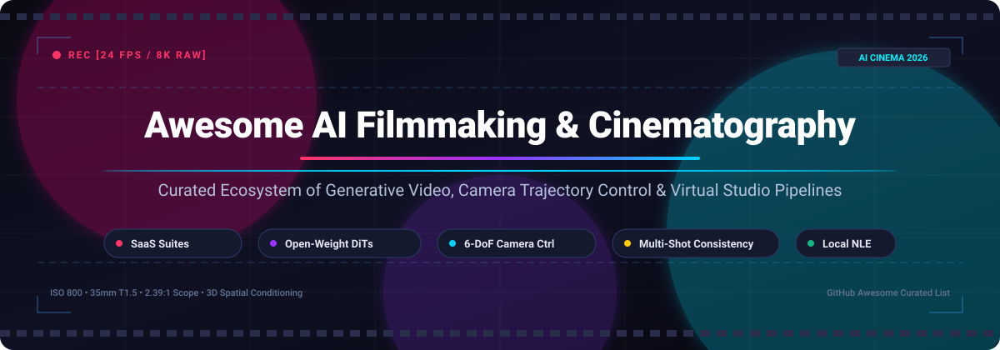

# 🎬 Awesome AI Filmmaking & Cinematography Tools [](https://github.com/ishandutta2007/Awesome-Awesome-Awesome)

<p align="center">
  
</p>

<p align="center">
  <a href="https://github.com/ishandutta2007/Awesome-Awesome-Awesome"></a><a href="https://discord.gg/jc4xtF58Ve"></a>
  <a href="https://github.com/ishandutta2007/Awesome-AI-Filmmaking-Cinematography-Tools/stargazers"></a>
  <a href="https://github.com/ishandutta2007/Awesome-AI-Filmmaking-Cinematography-Tools/network/members"></a>
  <a href="https://github.com/ishandutta2007/Awesome-AI-Filmmaking-Cinematography-Tools/blob/main/LICENSE"></a>
  <a href="https://github.com/ishandutta2007"></a>
</p>

---

## 📽️ Sector Overview & Market Dynamics

The global **AI video generation and AI filmmaking market** is valued at approximately **$1.24B to $1.4B in 2025–2026** (projected to exceed **$3.67B+ by late 2026** and **$16B+ by 2030** at an annual CAGR exceeding 19.5%), positioned inside the wider $30B+ Media & Entertainment AI sector. 

The sector is currently **moderately fragmented**: foundational video generation models are fiercely contested among well-funded frontier hyperscalers and venture-backed research labs (such as Kuaishou's Kling AI, Runway, Luma AI, and Alibaba's Wan team), while the surrounding production stack—encompassing 6-DoF virtual camera choreography, character consistency, shot pre-visualization, synchronized foley/audio synthesis, and local ComfyUI/NLE pipelines—remains distributed across specialized SaaS platforms and sovereign open-weight communities.

---

## 📋 Table of Contents

- [🌟 SaaS & Hosted Cinema Platforms](#-saas--hosted-cinema-platforms)
- [💻 Open-Source GitHub Projects](#-open-source-github-projects)
  - [Top Open-Source Filmmaking Repositories (Sorted by Stars)](#top-open-source-filmmaking-repositories-sorted-by-stars)
  - [Modular Cinema Pipeline Components](#modular-cinema-pipeline-components)
- [🤝 How to Contribute](#-how-to-contribute)
- [💖 Support & Sponsorship](#-support--sponsorship)
- [⭐ Star History](#-star-history)
- [📄 License & Disclaimer](#-license--disclaimer)

---

## 🌟 SaaS & Hosted Cinema Platforms

Below is a detailed breakdown of top commercial AI filmmaking, video generation, and virtual cinematography SaaS suites, ordered descending by company valuation / parent revenue scale.

| Platform | Company Valuation / Revenue | Starting Paid Tier | Free Tier Limits / Trial | Core Filmmaking Capabilities |
| :--- | :--- | :--- | :--- | :--- |
| **[Wonder Studio](https://wonderdynamics.com)** / **[Autodesk Flow](https://www.autodesk.com)** | **$60B+ Market Cap** (Parent: Autodesk acquired Wonder Dynamics; $5.5B+ annual rev) | **$10 / month** (Lite Plan; billed monthly) | **300 credits/mo free forever**, 720p watermarked video, 1 GB storage, up to 15s live-action CG motion capture per shot | Automated CG character animation, multi-camera lighting extraction, clean plate generation, and direct Blender/Maya USD export |
| **[Kling AI](https://klingai.com)** | **$18B – $20B Valuation** (Kuaishou carved entity; ~$500M ARR run-rate) | **$6.99 / month** (Standard Plan; promotional first month / $8.80 renewal) | **66 free credits daily upon login**, 720p resolution, watermarked clips, non-commercial personal usage | 1080p cinematic video generation, master camera movement presets, character lip-syncing, and multi-shot consistency |
| **[Runway](https://runwayml.com)** | **$5.3B Valuation** (Series E; $200M ARR) | **$15 / month** (Standard Plan; $12/mo billed annually) | **125 one-time free credits on signup** (never resets or refuels), 720p exports, non-commercial testing | Gen-3/Gen-4 cinema foundation models, Act-One performance capture, Directors Mode camera controls, and Motion Brush |
| **[Luma Dream Machine](https://lumalabs.ai)** | **$4.0B Valuation** (Series C; ~$80M ARR) | **$9.99 / month** (Lite Plan) / **$29.99 / month** (Plus Plan with commercial rights) | **30 free exploratory generations per month** (rate-limited daily), 720p resolution, watermarked, strictly non-commercial | Natural-language camera motions (pan/tilt/dolly), start/end keyframe interpolation, ray-traced lighting, and Modify Video editing |
| **[LTX Studio](https://ltx.studio)** | **$1.8B Valuation** (Parent: Lightricks; $250M+ annual revenue) | **$15 / month** (Lite Plan; $12/mo billed annually) | **800 one-time credits on registration** (never refills), 720p watermarked export, non-commercial evaluation only | Full script-to-film pre-visualization, automated multi-angle shot sequencing, consistent character casting, and sound design |
| **[Pika Labs (Pika Art)](https://pika.art)** | **$470M – $700M Valuation** (Series B; $15M–$30M ARR) | **$10 / month** (Starter Plan; $8/mo billed annually) | **80 recurring free credits per month**, watermarked exports, standard generation queue, personal non-commercial license | Pikaffects cinematic dynamics, Modify Region inpainting, camera rotate/pan/zoom controllers, and native audio synthesis |
| **[Leonardo.Ai](https://leonardo.ai)** | **$374M Valuation** (Acquired by Canva; multi-million ARR) | **$12 / month** (Essential Plan; $10/mo billed annually) | **150 fast tokens daily free forever** (resets every 24 hours, non-rollover), public generation feed | Motion animation for cinematic concept art and storyboards with adjustable motion intensity and camera direction |
| **[Viggle AI](https://viggle.ai)** | **$76M Valuation** (Series A led by a16z) | **$7.99 / month** (Pro Plan; $4.99/mo promotional starter) | **Daily free refresh credits**, 720p watermarked output, 7-day asset cloud storage, personal license | JST-1 physics-conditioned character performance control, actor body replacement, stunt choreography, and multi-actor blocking |
| **[Haiper](https://haiper.ai)** | **$32.6M Valuation / Backing** (Series A; B2B integration via NetMind.AI) | **$9.99 / month** (Explorer Plan; up to $24/mo Pro) | **10 free clip generations per day**, 720p/540p resolution, standard speed queue, non-commercial use | Perceptual video foundation models, controllable cinematic movement templates, and video-to-video style restyling |
| **[Kaiber](https://kaiber.ai)** | **$15M – $25M Valuation** (Seed-stage backed by EQT Ventures; ~$2.6M ARR) | **$10 / month** (Starter Plan; $8/mo billed annually) | **$5 for 5-day trial** (includes 500 credits and full access to Superstudio canvas and audio sync) | Audio-reactive cinema animation, frame-by-frame visual styling, camera choreography, and Superstudio canvas directing |
| **[DomoAI](https://domoai.app)** | **Bootstrapped / High-Growth** (Estimated $2M–$5M ARR) | **$9.99 / month** (Basic Plan; $6.99/mo billed annually for 500 credits) | **15 one-time free trial credits on signup** (no credit card required), watermarked test generations | Video-to-video cinema restyling, transforming live footage into stylized anime, 3D animated renders, and illustration styles |

---

## 💻 Open-Source GitHub Projects

Explore the open-weight foundations and independent software tools driving the open-source filmmaking and cinematography movement.

### Top Open-Source Filmmaking Repositories (Sorted by Stars)

Each project below is ordered by GitHub star count (descending) and features an interactive badge linked directly to its GitHub stargazers page.

1. **[ComfyUI](https://github.com/Comfy-Org/ComfyUI)** [](https://github.com/Comfy-Org/ComfyUI/stargazers)  
   The industry-standard node-based modular execution graph for generative AI cinema, driving local Wan2.1, HunyuanVideo, LTX-Video, and AnimateDiff pipelines.

2. **[Real-ESRGAN](https://github.com/xinntao/Real-ESRGAN)** [](https://github.com/xinntao/Real-ESRGAN/stargazers)  
   Practical restoration and upscaling algorithm for turning lower-resolution generative AI film plates into crisp 4K/8K cinema masters.

3. **[Open-Sora](https://github.com/hpcaitech/Open-Sora)** [](https://github.com/hpcaitech/Open-Sora/stargazers)  
   Open-source initiative democratizing efficient Diffusion Transformer video generation architecture with spatial-temporal DiTs.

4. **[Stability Generative Models (SVD / SVD-XT)](https://github.com/Stability-AI/generative-models)** [](https://github.com/Stability-AI/generative-models/stargazers)  
   Foundational open-weight image-to-video latent diffusion models turning still concept frames into temporally coherent camera shots.

5. **[AudioCraft](https://github.com/facebookresearch/audiocraft)** [](https://github.com/facebookresearch/audiocraft/stargazers)  
   Meta's deep learning library for synchronized cinema audio generation, foley sound design (AudioGen), and musical scoring (MusicGen).

6. **[Blender](https://github.com/blender/blender)** [](https://github.com/blender/blender/stargazers)  
   Premier open-source 3D creation suite, essential for virtual cinematography, 3D camera blocking, depth-map generation, and pre-visualization animatics.

7. **[SAM 2 (Segment Anything 2)](https://github.com/facebookresearch/sam2)** [](https://github.com/facebookresearch/sam2/stargazers)  
   Meta's visual foundation model for real-time video object segmentation, delivering automatic rotoscoping masks for AI filmmaking VFX composites.

8. **[LivePortrait](https://github.com/KlingAIResearch/LivePortrait)** [](https://github.com/KlingAIResearch/LivePortrait/stargazers)  
   Efficient portrait animation and facial performance retargeting framework for transferring real actor expressions and lip dynamics onto digital characters.

9. **[Wan2.1 / Wan2.2](https://github.com/Wan-Video/Wan2.1)** [](https://github.com/Wan-Video/Wan2.1/stargazers)  
   Alibaba's flagship Apache-2.0 open video foundation model suite delivering cinema-grade physics, cinematic lighting, and text/image-to-video synthesis.

10. **[FramePack](https://github.com/lllyasviel/FramePack)** [](https://github.com/lllyasviel/FramePack/stargazers)  
    Autoregressive video diffusion framework by Lvmin Zhang engineered to synthesize continuous long-horizon 30 fps video sequences on consumer GPUs.

11. **[DiffSynth-Studio](https://github.com/modelscope/DiffSynth-Studio)** [](https://github.com/modelscope/DiffSynth-Studio/stargazers)  
    ModelScope's comprehensive diffusion engine for long-form video synthesis, fast inference caching, and multi-model cinema pipeline integration.

12. **[CogVideoX](https://github.com/zai-org/CogVideo)** [](https://github.com/zai-org/CogVideo/stargazers)  
    THUDM / Zhipu AI's open-source 3D causal VAE diffusion transformer family designed for high-resolution cinematic video generation.

13. **[HunyuanVideo](https://github.com/Tencent-Hunyuan/HunyuanVideo)** [](https://github.com/Tencent-Hunyuan/HunyuanVideo/stargazers)  
    Tencent's 13B parameter open-weight video foundation model celebrated for cinematic color grading, realistic illumination, and ComfyUI workflows.

14. **[LTX-Video](https://github.com/Lightricks/LTX-Video)** [](https://github.com/Lightricks/LTX-Video/stargazers)  
    Lightricks' real-time open-source DiT video generation model capable of synthesizing high-frame-rate cinema clips with keyframe conditionings.

15. **[Depth Anything V2](https://github.com/DepthAnything/Depth-Anything-V2)** [](https://github.com/DepthAnything/Depth-Anything-V2/stargazers)  
    Monocular depth estimation model providing fine-grained 3D depth-map plates for virtual camera parallax and camera-control adapters.

16. **[Olive Video Editor](https://github.com/olive-editor/olive)** [](https://github.com/olive-editor/olive/stargazers)  
    Fast open-source node-based non-linear video editor (NLE) providing professional timeline editing and color workflows for generative footage.

17. **[MuseTalk](https://github.com/TMElyralab/MuseTalk)** [](https://github.com/TMElyralab/MuseTalk/stargazers)  
    Real-time high-quality audio-driven lip-synchronization model capable of dubbing and syncing actor dialogue in 30+ fps post-production pipelines.

18. **[StoryDiffusion](https://github.com/HVision-NKU/StoryDiffusion)** [](https://github.com/HVision-NKU/StoryDiffusion/stargazers)  
    Consistent self-attention framework for generating multi-shot comic and film storyboards with guaranteed character identity preservation.

19. **[Kdenlive](https://github.com/KDE/kdenlive)** [](https://github.com/KDE/kdenlive/stargazers)  
    Powerful open-source multi-track video editor by KDE featuring automated speech-to-text subtitling, color grading, and OpenTimelineIO support.

20. **[Natron](https://github.com/NatronGitHub/Natron)** [](https://github.com/NatronGitHub/Natron/stargazers)  
    Open-source node-based VFX compositor built on OpenFX standards, ideal for keying, rotoscoping, and multi-layer optical film finishing.

21. **[RIFE (Real-Time Video Frame Interpolation)](https://github.com/hzwer/ECCV2022-RIFE)** [](https://github.com/hzwer/ECCV2022-RIFE/stargazers)  
    Real-time optical flow frame interpolation model for converting 16 fps/24 fps AI video generations into ultra-smooth 60 fps cinema sequences.

22. **[Mochi 1](https://github.com/genmoai/mochi)** [](https://github.com/genmoai/mochi/stargazers)  
    Genmo's 10B parameter Asymmetric Diffusion Transformer (AsymmDiT) video generation architecture prioritizing prompt adherence and motion fidelity.

23. **[SkyReels-V1](https://github.com/SkyworkAI/SkyReels-V1)** [](https://github.com/SkyworkAI/SkyReels-V1/stargazers)  
    Diffusion-forcing open-source video generation model by Skywork AI designed for cinematic shot continuity and multi-camera directing.

24. **[MMAudio](https://github.com/hkchengrex/MMAudio)** [](https://github.com/hkchengrex/MMAudio/stargazers)  
    Multimodal video-to-audio synchronization framework generating time-aligned foley sound effects, ambient soundscapes, and cinematic music.

25. **[ComfyUI-VideoHelperSuite](https://github.com/Kosinkadink/ComfyUI-VideoHelperSuite)** [](https://github.com/Kosinkadink/ComfyUI-VideoHelperSuite/stargazers)  
    Essential video processing extension for ComfyUI enabling frame batching, multi-track audio pairing, previewing, and high-bitrate ProRes/H.265 encoding.

26. **[MotionCtrl](https://github.com/TencentARC/MotionCtrl)** [](https://github.com/TencentARC/MotionCtrl/stargazers)  
    SIGGRAPH 2024 unified camera pose and object motion controller for directing independent virtual camera trajectories and subject movement.

27. **[CameraCtrl](https://github.com/hehao13/CameraCtrl)** [](https://github.com/hehao13/CameraCtrl/stargazers)  
    Plücker-embedding camera controller module allowing exact 6-DoF trajectory choreography (dolly, truck, pedestal, pan, roll) in video diffusion models.

---

### Modular Cinema Pipeline Components

For directors and visual engineers assembling local or hybrid studio pipelines, here is how open-source repositories map across the production phases:

```
┌────────────────────────────────────────────────────────────────────────┐
│                   AI FILM PRODUCTION PIPELINE                          │
└────────────────────────────────────────────────────────────────────────┘
                                    │
    ┌───────────────────────────────┼──────────────────────────────┐
    ▼                               ▼                              ▼
【Pre-Visualization】      【Generative Video Plates】     【Post-Production & VFX】
• Blender Animatic Blocking • Wan2.1 / HunyuanVideo       • ComfyUI Node Graph
• StoryDiffusion Storyboard • LTX-Video / CogVideoX       • SAM 2 Object Roto
• CameraCtrl 6-DoF Plücker  • FramePack Autoregressive    • Real-ESRGAN Upscaling
• Stickman Pose Blocking    • Open-Sora Spatial-DiT       • RIFE Slow-Motion
                            • MotionCtrl Trajectory       • MuseTalk Dialogue Dub
                                                          • MMAudio / AudioCraft Foley
                                                          • Olive / Kdenlive Editing
                                                          • Natron Node Compositor
```

---

## 🤝 How to Contribute

Contributions are warmly welcomed! Help expand this directory of AI filmmaking and cinematography tools:

1. **Fork the repository** to your personal GitHub account.
2. **Create a branch** for your update:
   ```bash
   git checkout -b add/new-cinema-tool
   ```
3. **Add the platform or repository** following existing table/list formatting:
   - For SaaS products, please include precise starting subscription tiers, specific free trial or free-for-ever plan limits, and valuation/revenue scale metrics.
   - For open-source GitHub projects, include the full repo link and official description.
4. **Submit a Pull Request** with a descriptive summary of your contribution.

---

## 💖 Support & Sponsorship

If this curated collection helps your filmmaking projects, creative studios, or AI engineering workflows:

- ⭐ **Star this repository** to support discovery and visibility!
- 🍴 **Fork it** to customize your personal production stack.
- 📣 **Share it** with fellow cinematographers, VFX artists, and AI video creators.
- ☕ **Sponsor & Buy a Coffee**: If you'd like to support continued maintenance, visit the **[GitHub Sponsors Dashboard](https://github.com/sponsors/ishandutta2007)**!

Thank you to all creators and developers building the future of cinema! 🎬🍿

---

## ⭐ Star History

[](https://www.star-history.com/#ishandutta2007/Awesome-AI-Filmmaking-Cinematography-Tools&type=date&legend=top-left)

---

## 📄 License & Disclaimer

- Distributed under the [MIT License](LICENSE).
- All brand names, logos, trademarks, and registered trademarks cited belong to their respective owners. Mention does not imply formal endorsement or affiliation.
